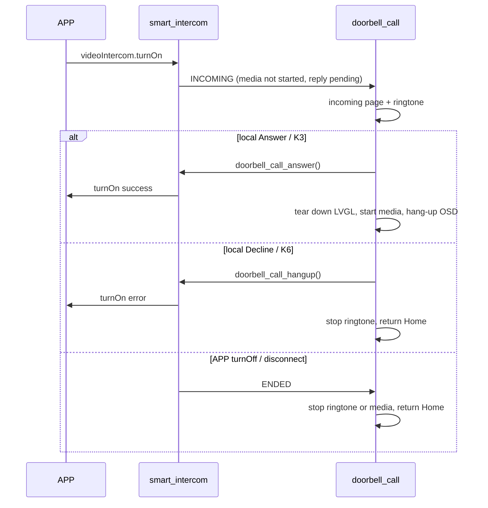

# intercom_indoor_display Project (BK7259 Indoor Intercom Display)

* [中文](./README_CN.md)

## 1 Overview

This project is the **indoor intercom display** in the doorbell solution. On top of the same JSON-RPC control plane and two-way A/V path as `video_intercom`, it adds a local **720×1280 LVGL UI** and an **invite / answer / hang-up** flow: when the phone starts a call the device rings first and waits for local confirmation; media starts only after the user answers.

**What this project adds:**

- **Local UI**: Home / Provisioning / Settings / Incoming Call, exported by Beken LVGL Designer into `ap/beken_generated/`. Business bindings live in `ap/ui/` and do not edit the generated sources.
- **Local answer**: `CONFIG_DOOR_ACCESS_CALL_FLOW=y`. The APP's `doorbell.videoIntercom.turnOn` is treated as an invite (the RPC reply is deferred until local answer or decline).
- **Unlock control**: Home **门禁** card and the incoming-call lock button share one lock state.
- **In-call OSD**: after answer, LVGL is torn down and a lock button + hang-up button plus a green call timer at the top are composited on the full-screen remote picture.
- **Downlink-only call**: `CONFIG_DOOR_ACCESS_CALL_LOCAL_UPLINK` is off by default — the call only decodes and shows the remote picture and does NOT capture/encode/upload the local camera; set it to `y` to also stream the local view back to the APP.

The two-way intercom media path (codec, networking, JSON-RPC method table, etc.) is shared with `video_intercom` and is not covered here — see the [video_intercom project documentation](../video_intercom/README.md).

## 2 Features

| Feature | Description |
| --- | --- |
| Indoor intercom display UI | 720×1280 portrait LVGL: Home, provisioning, settings, incoming call |
| Capacitive touch | `CONFIG_TP=y` (GT911, software I2C); ringing uses LVGL clicks, an active call uses OSD hit-test |
| Invite / local answer | APP `videoIntercom.turnOn` → incoming page + local ringtone; media starts only after answer |
| In-call OSD | after answer: full-screen remote picture + lock / red hang-up buttons at the bottom + green call timer at the top |
| Downlink-only call | `CONFIG_DOOR_ACCESS_CALL_LOCAL_UPLINK` off by default: show the remote picture only, no local camera uplink |
| Physical keys | ADC ladder K3–K6: provisioning / settings / back to Home; during a call K3 answers, K6 hangs up |

### 2.1 vs video_intercom

| Item | video_intercom | intercom_indoor_display |
| --- | --- | --- |
| Product | intercom endpoint; APP starts media in one shot | indoor intercom display; media starts after local confirm |
| Local UI | provisioning / Home intercom UI after boot | Designer indoor-display UI (unlock + incoming call) |
| `videoIntercom.turnOn` | starts uplink + downlink immediately | rings first; success reply on answer, error on decline |
| Call picture | remote main + local PIP | remote full screen (no PIP), lock/hang-up OSD + timer; downlink-only by default (no local uplink) |
| Key flags | `CONFIG_SMART_INTERCOM=y` | also `CONFIG_DOOR_ACCESS_CALL_FLOW=y`, `CONFIG_TP=y`, `CONFIG_BK_KEY=y`; `CONFIG_DOOR_ACCESS_CALL_LOCAL_UPLINK` off by default |

The protocol method names match `video_intercom`; only the **turnOn reply timing** differs.

## 3 Quick Start

### 3.1 Hardware

- BK7259 board
- MIPI camera (GC2053, 1280×720@30fps)
- MIPI LCD (ER68576B, 720×1280 portrait)
- Capacitive touch panel (EVB LVGL reference pins by default: SCL GPIO_0, SDA GPIO_1, RST GPIO_5, INT GPIO_6; verify against the indoor-display schematic before flashing)
- Speaker / Mic
- microSD card (FAT32; boot animation `/sd0/boot.mp4`, see [3.5](#35-boot-animation))

### 3.2 Build

This is a **solution** project (`bk_solution_*`). Build from the project directory and point `SDK_DIR` at the SDK root (the solution root has no `tools/`). Do **not** pass `PROJECT=`.

```bash
cd projects/intercom_indoor_display
make bk7259 SDK_DIR=/abs/path/to/bk_avdk_smp_release_4.0.1 -j32
```

Output: `projects/intercom_indoor_display/build/bk7259/intercom_indoor_display/package/all-app.bin`

### 3.3 Key config options

The options in `ap/config/bk7259_ap/defconfig` that distinguish this project from `video_intercom`:

```ini
CONFIG_SMART_INTERCOM=y
CONFIG_DOOR_ACCESS_CALL_FLOW=y   # invite / local answer (this project's core)
# CONFIG_DOOR_ACCESS_CALL_LOCAL_UPLINK is not set  # upload local camera during a call, off by default (downlink-only)
CONFIG_TP=y                      # capacitive touch
CONFIG_TP_GT911=y
CONFIG_BK_KEY=y                  # K3–K6 ADC keys
CONFIG_BOOT_VIDEO_PLAYER=y
```

Touch pins are `CONFIG_TP_*`. GPIO_7 is the panel backlight, **not** a lock-drive pin.

`CONFIG_DOOR_ACCESS_CALL_LOCAL_UPLINK` is defined in `components/smart_intercom/Kconfig` and only applies when `CONFIG_DOOR_ACCESS_CALL_FLOW=y`: off (default) = the call only decodes and shows the remote picture, no local capture/H.264/upload; `=y` = also publish the indoor unit's camera to the APP (two-way video like `video_intercom`).

### 3.4 Demo

1. Provision over BLE with the BekenIot APK (same as doorbell / video_intercom).
2. After the boot animation, Home is shown (Provisioning if not yet provisioned).
3. Tap Home **门禁**: the card turns green and the icon switches to unlocked; tap again to restore the dark closed-lock look. The label stays "门禁".
4. The phone starts an intercom call: the device switches to the incoming page and rings. Use **接听** / **拒绝**, or tap the center lock (已锁定 ↔ 已开锁, shared with Home).
5. After answer the remote picture is full screen; a green call timer counts up at the top and the lock / red hang-up buttons sit at the bottom. Tap hang-up to end and return Home. The local camera is not uploaded by default.

**通话**, **监控**, **记录** and the other Home tiles, plus the switches on Settings, are visual placeholders only. Provisioning is entered from Settings **配网** (or K3).

### 3.5 Boot animation

Default `CONFIG_BOOT_VIDEO_PLAYER=y` plays `/sd0/boot.mp4` from the SD card (volume 80, `BOOT_VIDEO_ROTATE_AUTO`) and keeps the panel lit for LVGL (`BOOT_VIDEO_DISPLAY_KEEP_ON`). Alternative `CONFIG_BOOT_IMAGE_PLAYER=y` shows `/sd0/boot.jpg`. When both flags are on the image wins; when both are off the UI comes up immediately. Author assets at panel native 720×1280.

## 4 Layout

```
projects/intercom_indoor_display
├── ap/
│   ├── ap_main.c                 # board MIPI camera/LCD/GPU + boot media + doorbell init
│   ├── key_map.c                 # K3–K6: provisioning/settings/Home; answer/hang-up during a call
│   ├── ui/
│   │   ├── doorbell_ui.c         # LVGL lifecycle, provisioning fill, Home unlock bind
│   │   ├── doorbell_call.c       # incoming page, answer/decline, OSD lock/hang-up/timer
│   │   ├── doorbell_ringtone.c   # local ringtone (owns the speaker until answer)
│   │   ├── hangup_icon.c         # in-call OSD hang-up sprite (144×144 ARGB8888)
│   │   ├── lock_osd_icon.c       # in-call OSD lock open/closed sprites (144×144 ARGB8888)
│   │   ├── osd_call_timer.c/.h   # in-call timer OSD (256×48 ARGB8888, green digits, repaint/s)
│   │   └── osd_digit_font.c/.h   # bitmap digit font used by the timer
│   ├── beken_generated/          # Designer export; replace as a whole directory; do not hand-edit
│   └── config/bk7259_ap/defconfig
├── cp/                           # IPC / keepalive / powerctrl (same class as doorbell)
├── partitions/bk7259/
├── Makefile                      # must pass SDK_DIR pointing at the SDK
└── dbuild.sh
```

Click handling for the generated UI lives in `ap/ui/`: `doorbell_ui.c` binds Home, `doorbell_call.c` binds the incoming page. After a Designer re-export, overwrite `beken_generated/` and re-attach bindings by widget name.

## 5 Implementation

### 5.1 Invite / answer / hang-up

The APP protocol is unchanged; only the success/error reply to `videoIntercom.turnOn` is deferred:



The answer path must yield the panel/HSRAM to the video pipeline (tear down LVGL) before `doorbell_call_answer()`. On decline LVGL is still up, so the UI just returns Home. After hang-up or a remote end, LVGL is rebuilt.

Local request entry points: `doorbell_call_request_answer()` / `doorbell_call_request_hangup()` (enqueue from any thread; heavy work runs on the call worker).

### 5.2 Local pages

| Page | How you get there | Wired actions |
| --- | --- | --- |
| Home | provisioned boot / call end / K5 | Settings, 门禁 unlock |
| Provisioning | unprovisioned boot / Settings 配网 / K3 | back to Home; status line shows provisioning progress |
| Settings | Home 设置 / K4 | back to Home, 配网 |
| Incoming Call | APP invite | 接听, 拒绝, lock button |

Home has no live camera preview; the clock and notify area are display-only.

### 5.3 In-call OSD (lock / hang-up / timer)

After answer LVGL is gone; a dedicated touch thread hit-tests the OSD:

- Lock button: `ap/ui/lock_osd_icon.c` (144×144, open/closed sprites), bottom-left `dst_x=180`; a hit toggles the door state (shared with Home / the incoming page) and redraws the icon.
- Hang-up button: `ap/ui/hangup_icon.c` (144×144, same red circle + handset as incoming Decline), bottom-right `dst_x=396`; both buttons at `dst_y=1060`. A hit uses the same `doorbell_call_request_hangup()` as Decline / K6.
- Call timer: `ap/ui/osd_call_timer.c` + `osd_digit_font.c` (256×48 ARGB8888).
- Compose: `doorbell_compositor_osd_show()`; with GPU pre-rotation 90°/270° sprites are placed in post-rotation panel coordinates. The three elements refresh incrementally by stable name (`lock`/`hangup`/`time`).

### 5.4 Physical keys

Board: BK7259 QFN128 EVB. K3–K6 are a resistor ladder on P25 / ADC1.

| Key | Idle | Ringing or in a call |
| --- | --- | --- |
| K3 short | erase netcfg and enter Provisioning | answer |
| K4 short | Settings | ignored |
| K5 short | Home | ignored |
| K6 short | erase netcfg | hang up / decline |
| K6 long | factory reset (erase netcfg + factory reset + reboot) | ignored |
