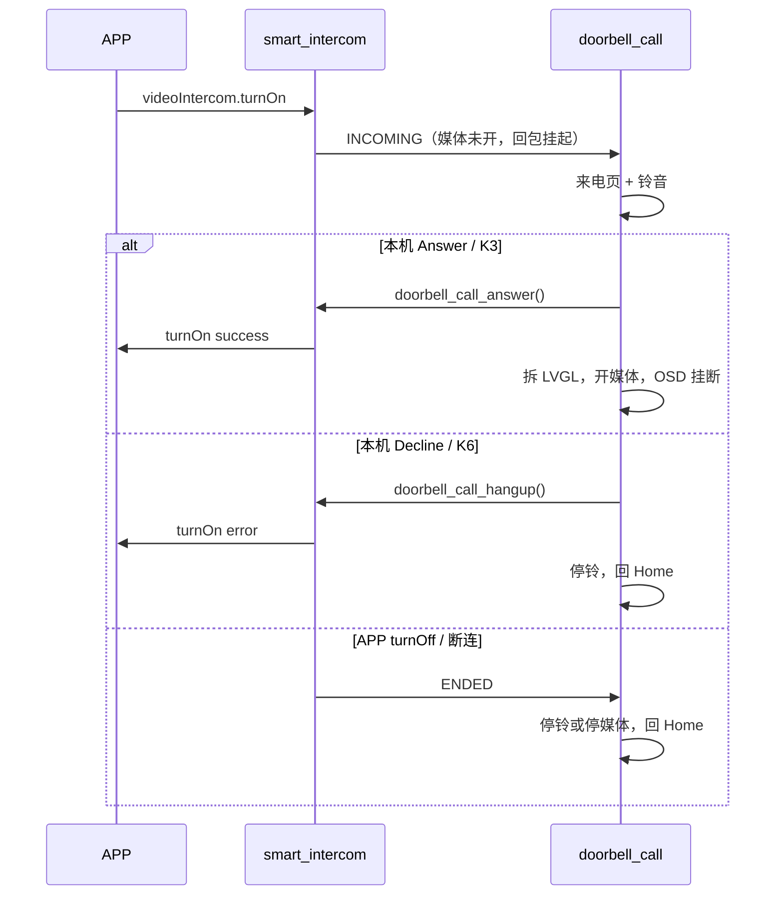

# intercom_indoor_display 项目（BK7259 室内对讲显示屏）

* [English](./README.md)

## 1 项目概述

本项目是 doorbell 解决方案中的 **室内对讲显示屏（indoor intercom display）**。它在 `video_intercom` 同一套 JSON-RPC 控制面与双向音视频能力之上，增加本机 **720×1280 LVGL 界面** 和 **来电邀请 / 接听 / 挂断** 流程：手机发起通话时设备先响铃并等待本机确认，接听后才打开媒体通路。

**本工程独有能力**：

- **本地 UI**：Home / Provisioning / Settings / Incoming Call，由 Beken LVGL Designer 导出到 `ap/beken_generated/`，业务绑定写在 `ap/ui/`，不改生成代码。
- **本机接听**：`CONFIG_DOOR_ACCESS_CALL_FLOW=y`。APP 的 `doorbell.videoIntercom.turnOn` 视为来电邀请（RPC 回包推迟到本机接听或拒接）。
- **开锁控制**：Home 的 **门禁** 卡片与来电页门锁按钮共用同一把锁状态。
- **通话中 OSD**：接听后拆除 LVGL，在对端全屏画面上叠 OSD 门锁键 + 挂断键，以及顶部绿色通话计时。
- **纯下行通话**：`CONFIG_DOOR_ACCESS_CALL_LOCAL_UPLINK` 默认关闭——通话只解码显示对端画面，不采集/编码/上传本机摄像头；置 `y` 才把本机画面回传给 APP。

音视频对讲通路（编解码、组网、JSON-RPC 方法表等）与 `video_intercom` 共用，本文不展开，见 [video_intercom 工程文档](../video_intercom/README_CN.md)。


## 2 功能特性

| 特性 | 说明 |
| --- | --- |
| 室内对讲显示屏 UI | 720×1280 竖屏 LVGL：Home、配网、设置、来电 |
| 电容触摸 | `CONFIG_TP=y`（GT911，软件 I2C）；来电响铃走 LVGL 点击，通话中走 OSD 命中 |
| 来电邀请 / 本机接听 | APP `videoIntercom.turnOn` → 来电页 + 本地铃音；接听后才开媒体 |
| 通话中 OSD | 接听后全屏对端画面 + 底部门锁 / 红色挂断键 + 顶部绿色通话计时 |
| 纯下行通话 | `CONFIG_DOOR_ACCESS_CALL_LOCAL_UPLINK` 默认关：只显示对端画面，不上传本机摄像头 |
| 物理按键 | ADC 阶梯 K3–K6：配网 / 设置 / 回 Home；通话中 K3 接听、K6 挂断 |

### 2.1 与 video_intercom 的差异

| 对比项 | video_intercom | intercom_indoor_display |
| --- | --- | --- |
| 产品形态 | 对讲终端，APP 一键开媒体 | 室内对讲显示屏，本机确认后才开媒体 |
| 本机 UI | 开机后进配网/Home 的对讲 UI | Designer 室内屏界面（含开锁 / 来电） |
| `videoIntercom.turnOn` | 立即开上行+下行 | 先来电；接听才成功回包，拒接回错误 |
| 通话画面 | 对端主画面 + 本机 PIP | 对端全屏（无 PIP），OSD 门锁/挂断 + 计时；默认纯下行，不上传本机画面 |
| 关键宏 | `CONFIG_SMART_INTERCOM=y` | 另开 `CONFIG_DOOR_ACCESS_CALL_FLOW=y`、`CONFIG_TP=y`、`CONFIG_BK_KEY=y`；`CONFIG_DOOR_ACCESS_CALL_LOCAL_UPLINK` 默认关 |

协议方法名与 `video_intercom` 相同，仅 **turnOn 回包时机** 不同。

## 3 快速开始

### 3.1 硬件准备

- BK7259 开发板
- MIPI 摄像头（GC2053，1280×720@30fps）
- MIPI LCD（ER68576B，720×1280 竖屏）
- 电容触摸屏（默认按 EVB LVGL 参考脚：SCL GPIO_0、SDA GPIO_1、RST GPIO_5、INT GPIO_6；烧录前按室内屏板原理图核对）
- Speaker / Mic
- microSD 卡（FAT32；开机动画 `/sd0/boot.mp4`，见 [3.5](#35-开机动画)）

### 3.2 编译

本工程是 **solution**（`bk_solution_*`），须在工程目录编译，并把 `SDK_DIR` 指到 SDK 根（solution 根没有 `tools/`）。**不要**传 `PROJECT=`。

```bash
cd projects/intercom_indoor_display
make bk7259 SDK_DIR=/abs/path/to/bk_avdk_smp_release_4.0.1 -j32
```

产物：`projects/intercom_indoor_display/build/bk7259/intercom_indoor_display/package/all-app.bin`

### 3.3 关键配置项

`ap/config/bk7259_ap/defconfig` 中相对 `video_intercom` 的核心开关：

```ini
CONFIG_SMART_INTERCOM=y
CONFIG_DOOR_ACCESS_CALL_FLOW=y   # 来电邀请 / 本机接听（本工程核心）
# CONFIG_DOOR_ACCESS_CALL_LOCAL_UPLINK is not set  # 通话是否上传本机摄像头，默认关（纯下行）
CONFIG_TP=y                      # 电容触摸
CONFIG_TP_GT911=y
CONFIG_BK_KEY=y                  # K3–K6 ADC 按键
CONFIG_BOOT_VIDEO_PLAYER=y
```

触摸脚位见 `CONFIG_TP_*`。GPIO_7 是面板背光，**不是**门锁驱动脚。

### 3.4 演示流程

1. BekenIot APK 完成 BLE 配网（与 doorbell / video_intercom 相同）。
2. 开机动画结束后进入 Home（未配网则进 Provisioning）。
3. 点 Home **门禁**：卡片变绿、图标改为开锁；再点一次恢复深色闭锁。文案始终为 “门禁”。
4. 手机发起对讲：设备切到来电页并响铃。可 **接听** / **拒绝**，或点中间门锁（已锁定 ↔ 已开锁，与 Home 共用状态）。
5. 接听后全屏对端画面，顶部绿色计时开始走秒，底部为门锁 / 红色挂断键；点挂断键结束，回到 Home。默认不上传本机画面。

Home 上 **通话**、**监控**、**记录** 等以及 Settings 里的开关目前仅为界面占位，未接业务。配网入口在 Settings 的 **配网** 按钮（或 K3）。

### 3.5 开机动画

默认 `CONFIG_BOOT_VIDEO_PLAYER=y`，从 SD 卡播放 `/sd0/boot.mp4`（音量 80，`BOOT_VIDEO_ROTATE_AUTO`），播完保持亮屏交给 LVGL（`BOOT_VIDEO_DISPLAY_KEEP_ON`）。备选 `CONFIG_BOOT_IMAGE_PLAYER=y` 则显示 `/sd0/boot.jpg`。两个宏同时开时优先图片；都关则开机直接进 UI。素材按面板 720×1280 制作。

## 4 工程目录

```
projects/intercom_indoor_display
├── ap/
│   ├── ap_main.c                 # 板级 MIPI 摄像头/LCD/GPU + 开机媒体 + doorbell 初始化
│   ├── key_map.c                 # K3–K6：配网/设置/Home；通话中接听/挂断
│   ├── ui/
│   │   ├── doorbell_ui.c         # LVGL 生命周期、配网页填充、Home 开锁绑定
│   │   ├── doorbell_call.c       # 来电页、接听/拒接、OSD 门锁/挂断/计时
│   │   ├── doorbell_ringtone.c   # 来电本地铃音（接听前占用扬声器）
│   │   ├── hangup_icon.c         # 通话中 OSD 挂断图（144×144 ARGB8888）
│   │   ├── lock_osd_icon.c       # 通话中 OSD 门锁开/闭图（144×144 ARGB8888）
│   │   ├── osd_call_timer.c/.h   # 通话计时 OSD（256×48 ARGB8888，绿色数字，每秒重绘）
│   │   └── osd_digit_font.c/.h   # 计时用位图数字字体
│   ├── beken_generated/          # Designer 导出，整目录替换；不要手改
│   └── config/bk7259_ap/defconfig
├── cp/                           # IPC / keepalive / powerctrl（同 doorbell 类工程）
├── partitions/bk7259/
├── Makefile                      # 必须带 SDK_DIR 指向 SDK
└── dbuild.sh
```

生成 UI 的点击逻辑写在 `ap/ui/`：`doorbell_ui.c` 绑 Home，`doorbell_call.c` 绑来电页。Designer 重新导出后覆盖 `beken_generated/` 即可，业务绑定按控件名重新挂上。

## 5 实现机制

### 5.1 来电 / 接听 / 挂断

APP 协议不变，只推迟 `videoIntercom.turnOn` 的成功/失败回包：



接听路径必须先把面板/HSRAM 让给视频通路（拆除 LVGL），再 `doorbell_call_answer()`。拒接时 LVGL 仍在，直接回 Home。挂断或对端结束后再重建 LVGL。

本机请求入口：`doorbell_call_request_answer()` / `doorbell_call_request_hangup()`（任意线程入队，重活在 call worker 上执行）。

### 5.2 本地页面

| 页面 | 入口 | 已接线的操作 |
| --- | --- | --- |
| Home | 已配网开机 / 通话结束 / K5 | 设置、门禁开锁 |
| Provisioning | 未配网开机 / Settings 配网 / K3 | 回 Home；状态行提示配网进度 |
| Settings | Home 设置 / K4 | 回 Home、配网 |
| Incoming Call | APP 来电邀请 | 接听、拒绝、门锁按钮 |

Home 无实时摄像头预览；时钟与通知区为界面展示。

### 5.3 通话中 OSD（门锁 / 挂断 / 计时）

接听后 LVGL 已拆除，触摸由独立线程对 OSD 做命中：

- 门锁键：`ap/ui/lock_osd_icon.c`（144×144，开/闭两张图），底部左侧 `dst_x=180`；点中切换门锁状态（与 Home / 来电页共用状态）并重绘图标。
- 挂断键：`ap/ui/hangup_icon.c`（144×144，与来电 Decline 红圈+听筒一致），底部右侧 `dst_x=396`；两键同处 `dst_y=1060`。点中走与 Decline / K6 相同的 `doorbell_call_request_hangup()`。
- 通话计时：`ap/ui/osd_call_timer.c` + `osd_digit_font.c`（256×48 ARGB8888）。
- 合成：`doorbell_compositor_osd_show()`；GPU 预旋转 90°/270° 时按旋转后的面板坐标放置。三个元素以稳定 name（`lock`/`hangup`/`time`）增量刷新。

### 5.4 物理按键

板级：BK7259 QFN128 EVB，K3–K6 为 P25 / ADC1 电阻分压。

| 键 | 空闲 | 来电响铃或通话中 |
| --- | --- | --- |
| K3 短按 | 清配网并进入 Provisioning | 接听 |
| K4 短按 | Settings | 忽略 |
| K5 短按 | Home | 忽略 |
| K6 短按 | 清除配网 | 挂断 / 拒接 |
| K6 长按 | 恢复出厂（清配网 + factory reset + 重启） | 忽略 |
